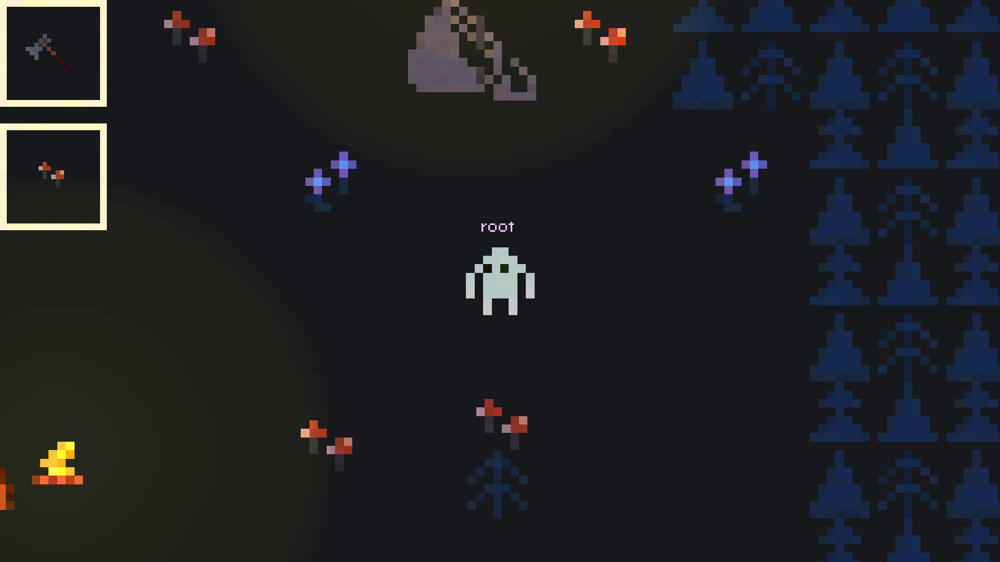

# Название проекта / Темы 

> **Дата:** 06.11.2026
> **Автор (ФИО):** Заволока Николай Николаевич

--- 
 

## Описание проекта 
Проект включает настройки отображения, рендеринга, автозагрузку скриптов и ввод с клавиатуры, в гемплее можно переиспользовать предметы

## Стек проекта 
* **Игровой движок / Платформа:** Godot Engine 4.x 
* **Язык программирования:** GDScript
* **Дополнительные инструменты:** Git, Blender 

## Что было использовано в проекте 
* **Узлы (Nodes):** Area2D, CanvasLayer, CharacterBody2D 
* **Паттерны / Подходы:** Глобальный код (Global.gd), Сигналы (Signals) 
* **Ресурсы:** Кастомные спрайты, UI-шрифты 

## Самостоятельные работы 
* **Имя игрока**: Да
* **Переход на другую сцену**: Да
